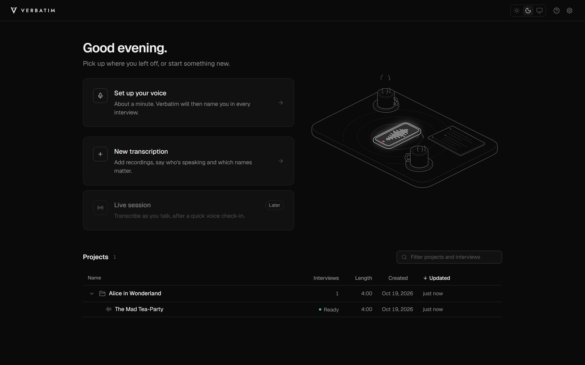
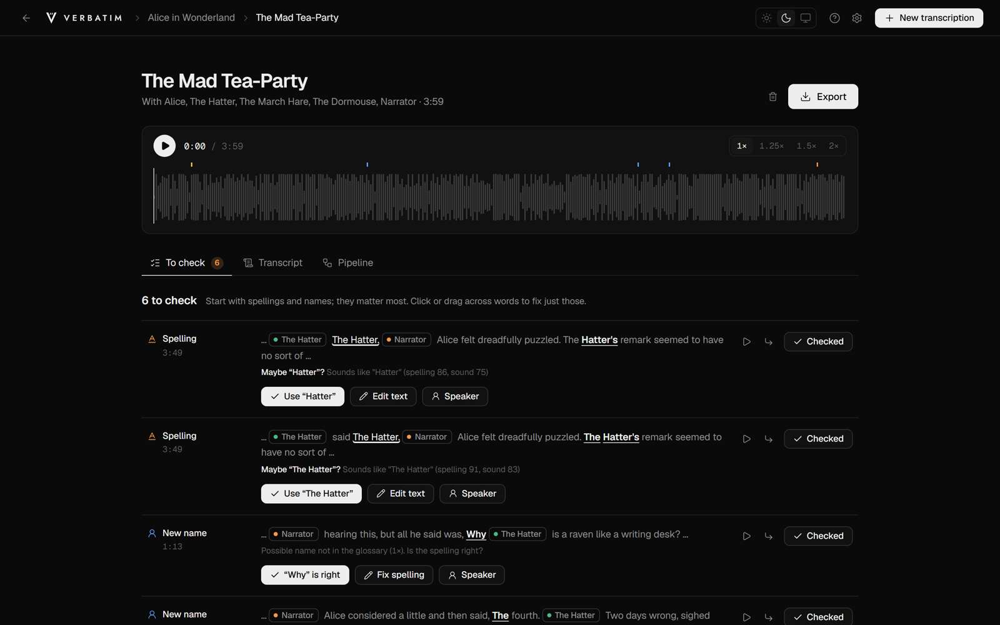
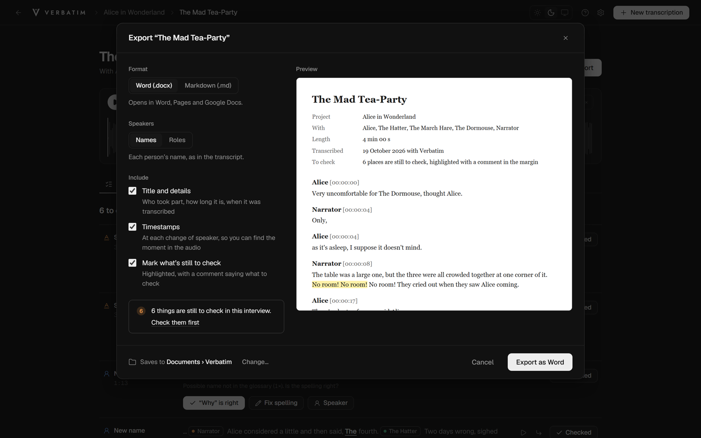
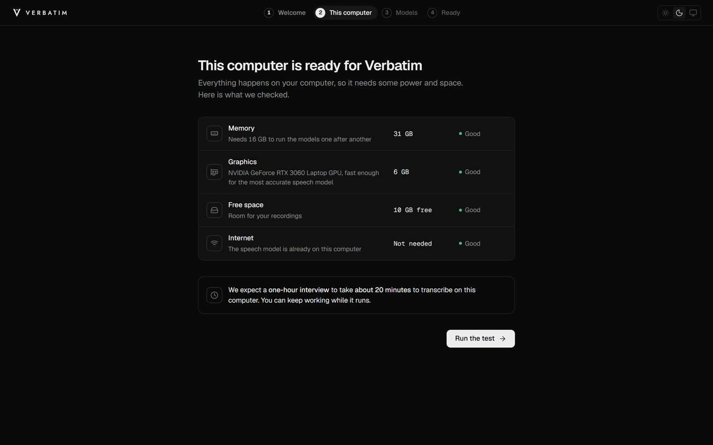
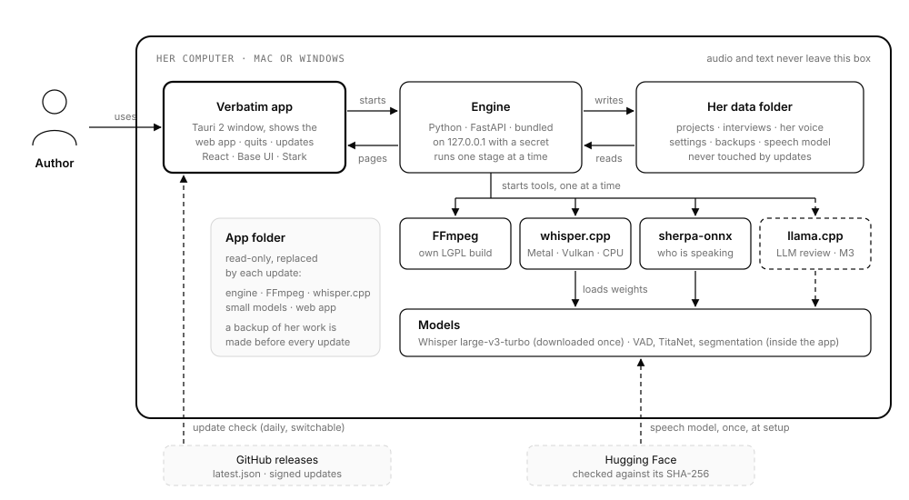

<h1 align="center">Verbatim</h1>

<b>Interview transcripts you can trust, made on your own computer.</b>

Verbatim turns recorded interviews into transcripts with names on the voices, and lists what it
isn't sure about, so you check a handful of things instead of every line. Your recordings and
transcripts never leave your computer.

**[Download the newest version](../../releases/latest)** for Mac (Apple Silicon) or Windows.
This repository only holds the app's releases.

## What it does

- **Transcribes on your own computer.** Recordings from your phone (M4A, MP3, WAV and more) become
  transcripts with timestamps. Nothing is uploaded: no account, no cloud, no tracking.
- **Puts names on the voices.** Name a voice once and Verbatim recognises it in later interviews
  of the same project. It learns your own voice once, so you're named in every interview.
- **Knows your names and terms.** Tell it who's in the interview and the people, places and words
  that matter; it spells them right and learns the spellings you confirm.
- **Tells you what to check.** Instead of guessing, it lists what it isn't sure about: unclear
  words, names that might be misspelled, new names, people talking over each other. Click to hear
  the moment, fix it in place.
- **Easy to fix.** Review the transcript beside the recording's waveform; click any word to hear
  it; move words to the right speaker with a click or a drag.
- **Exports to Word or Markdown,** one interview or a whole project, with what's still to check
  highlighted (and noted in the margin in Word).
- **Guided setup.** It checks your computer, downloads the speech model once (resuming if the
  connection drops, verified when it arrives) and runs a short test before your first interview.
- **Safe updates.** One click installs a new version, checked against our signature; your work is
  backed up first and never touched.

## Screenshots

The screenshots show a public-domain LibriVox reading of <i>Alice's Adventures in Wonderland</i>
(chapter 7), not a real interview.

## How it fits together

Everything runs on your computer. Only two things ever go online: downloading the speech model
once during setup, and the update check, which you can switch off. More detail, including each
step an interview goes through, is in [docs/architecture.html](docs/architecture.html)
(GitHub shows its source: download it and open it in your browser).

## What you need

- **Mac:** Apple Silicon (M1 or newer) with at least 16 GB of memory.
- **Windows:** 64-bit Windows 10 or 11 with at least 16 GB of memory. A graphics chip with 4 GB
  of its own memory makes it fast; without one it still works, more slowly.
- About 2 GB of free space, plus room for your recordings. Setup downloads the speech model
  (1.6 GB) once; after that Verbatim works without the internet.

## Installing on a Mac

1. Download `Verbatim_…_aarch64.dmg`, open it, and drag **Verbatim** to **Applications**.
2. Open Verbatim. macOS says it can't check it: Verbatim is free and isn't part of Apple's paid
   developer programme. Click **Done** (or **Cancel**).
3. Open **System Settings › Privacy & Security**, scroll down, and click **Open Anyway** next to
   Verbatim. Confirm with your password.

You only do this once. Updates install from inside the app.

## Installing on Windows

1. Download `Verbatim_…_x64-setup.exe` and run it.
2. Windows SmartScreen shows a blue box, "Windows protected your PC": Verbatim is free and isn't
   signed through Microsoft's paid programme. Click **More info**, check that the app is
   **Verbatim**, then click **Run anyway**.
3. The installer asks no questions. Verbatim opens when it's done.

You only do this once. Updates install from inside the app.

## Is the download really from us?

Each release lists the **SHA-256 checksum** of every file. To check a download:

- Mac: in Terminal, `shasum -a 256 ~/Downloads/Verbatim_*.dmg`
- Windows: in PowerShell, `Get-FileHash $HOME\Downloads\Verbatim_*-setup.exe`

The result must match the release page exactly. Updates installed from inside the app are
checked automatically against our signature before they run.

## Privacy

Verbatim uses the internet for two things only: downloading the speech model once during
setup (from Hugging Face), and checking this page for updates, which you can switch off. Nothing
about you, your recordings or your transcripts is ever sent.

## Licences

Verbatim is made by Ari Kohn. The app's Help › Credits lists every model and tool it uses.
It bundles FFmpeg (LGPL 2.1 or later) to read audio files; the exact FFmpeg source used is
attached to each release. The screenshots use a public-domain recording from LibriVox.
